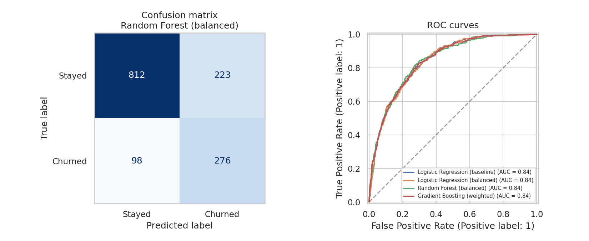
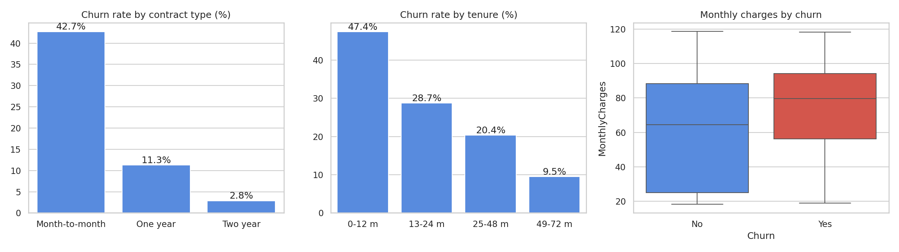
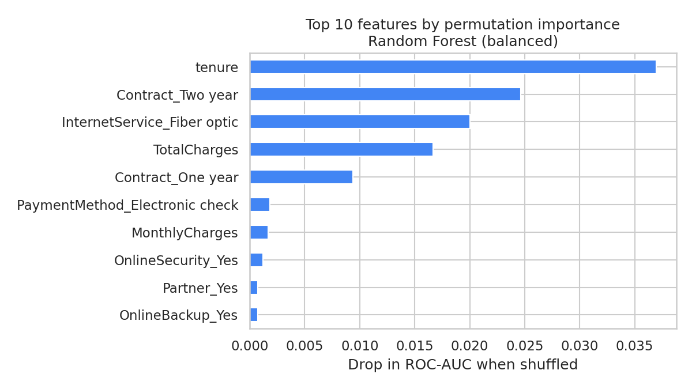

# Telco Customer Churn Prediction

Which telecom customers are likely to cancel, and what is associated with it? This project explores 7,043 customer records, compares four classification models, handles the class imbalance (only 26.5% of customers churn), and evaluates with precision, recall, F1, and ROC-AUC instead of accuracy alone.



## Key findings

| Finding | Result |
|---|---|
| Overall churn | **26.5%** (1,869 of 7,043 customers) |
| Contract type | Month-to-month **42.7%** churn, one-year 11.3%, two-year 2.8% |
| Time as a customer | **47.4%** churn in the first 12 months, falling to 28.7% (13–24 m), 20.4% (25–48 m), and 9.5% (49–72 m) |
| Internet service | Fiber optic customers churn at **41.9%**, versus 19.0% for DSL and 7.4% without internet |
| Payment method | Electronic check **45.3%**, versus 15.2%–19.1% for the three other methods |
| Monthly charges | Customers who churned pay visibly more per month than those who stayed |
| Model quality | All four models reach a ROC-AUC of **0.84** on the test set |
| Most influential features | Tenure, two-year contract, fiber optic service, and total charges (permutation importance) |

These are associations in observational data. They do not show what *causes* customers to leave.

## Model comparison (20% test set, 1,409 customers)

| Model | Accuracy | Precision | Recall | F1 | ROC-AUC |
|---|---|---|---|---|---|
| Logistic Regression (baseline) | 0.807 | 0.658 | 0.567 | 0.609 | 0.842 |
| Logistic Regression (balanced) | 0.740 | 0.507 | 0.786 | 0.616 | 0.841 |
| Random Forest (balanced) | 0.772 | 0.553 | 0.738 | 0.632 | 0.843 |
| Gradient Boosting (weighted) | 0.743 | 0.510 | 0.797 | 0.622 | 0.843 |

How to read it:
- **Accuracy is misleading here.** Always predicting "customer stays" is already 73.5% accurate.
- **The four models rank customers almost equally well** (ROC-AUC 0.841–0.843, a difference that is within noise). The choice between them is not about better predictions.
- **Handling the imbalance changes the trade-off, not the ranking.** The unweighted logistic regression has the highest accuracy but finds only 57% of churners. Class weights raise recall to 79% at the cost of precision.
- Random Forest (balanced) was used for the detailed analysis below. It ties with Gradient Boosting on ROC-AUC and has the highest F1.

### Random Forest (balanced): confusion matrix at threshold 0.5

Of 374 customers who churned, **276 were identified** and 98 were missed. Of 1,035 who stayed, 223 were flagged by mistake.

## Choosing the decision threshold

In a retention campaign, missing a churner usually costs more than contacting a loyal customer, so the threshold can be lowered

| Threshold | Precision | Recall | F1 | Customers flagged (of 1,409) |
|---|---|---|---|---|
| 0.3 | 0.451 | 0.869 | 0.594 | 721 |
| 0.4 | 0.512 | 0.824 | 0.632 | 601 |
| 0.5 | 0.553 | 0.738 | 0.632 | 499 |
| 0.6 | 0.604 | 0.604 | 0.604 | 374 |
| 0.7 | 0.684 | 0.487 | 0.569 | 266 |

At 0.4, contacting 601 customers catches 82% of those who would churn, and about half of the people contacted would have churned. The right threshold depends on the cost of an offer versus the value of a retained customer, which is not in this dataset.

## What the findings suggest (hypotheses to test, not conclusions)

- **Retention effort is most valuable early.** Nearly half of customers in their first year churn, and month-to-month customers churn far more than those on annual contracts. Offers that move new customers to longer contracts are worth testing.
- **Fiber optic and electronic-check customers churn much more.** The data cannot say why. Service quality, price, or payment friction are possible explanations to investigate, for example with surveys or an A/B test.
- **A model can prioritize who to contact**, so a limited retention budget goes to the highest-risk customers.




## Method

1. **Cleaning:** `TotalCharges` is read as text because 11 rows are blank. All 11 are new customers with `tenure = 0` who have not been billed yet, so the value is set to 0. The customer ID is dropped.
2. **Features:** categorical columns are one-hot encoded (30 features after encoding).
3. **Split:** 80/20 with `stratify`, so train and test keep the same 26.5% churn share.
4. **Models:** logistic regression (with and without balanced class weights), random forest (balanced), and gradient boosting (balanced sample weights).
5. **Evaluation:** accuracy, precision, recall, F1, ROC-AUC, confusion matrix, and a threshold analysis.
6. **Interpretation:** permutation importance on the test set (drop in ROC-AUC when a feature is shuffled).

## Limitations

- **Single train/test split.** The best model is chosen on the same test set that is reported, so the results are slightly optimistic. Cross-validation or a separate validation set would be more rigorous.
- **Model differences are tiny.** No statistical test was run, and the four models should be considered equivalent in ranking ability.
- **Default hyperparameters.** No tuning was done.
- **Threshold analysis is on the test set** and is meant to illustrate the trade-off, not to set a production threshold.
- **22 rows are identical** once the customer ID is removed. They are kept, since customers with the same plan can legitimately look alike.
- **Correlated features** (tenure, total charges, contract type) share importance, so permutation importance can understate each one.
- **Observational data.** Associations are not causes.

## Data

- **Source:** [Telco Customer Churn](https://www.kaggle.com/datasets/blastchar/telco-customer-churn) on Kaggle (7,043 rows, 21 columns)
- **License:** "Data files © Original Authors" (as stated on the Kaggle page). The data is **not redistributed** in this repository. Download it from Kaggle to reproduce the analysis.

## Repository structure

```
├── notebooks/   telco_churn_prediction.ipynb
├── images/      result figures
└── README.md
```

## How to run

1. Download `WA_Fn-UseC_-Telco-Customer-Churn.csv` from Kaggle.
2. Open `notebooks/telco_churn_prediction.ipynb` in Google Colab and upload the CSV to the session.
3. Run all cells (Runtime → Run all). Random seeds are fixed, so the results are reproducible.

## Tools

Python · pandas · scikit-learn · seaborn · matplotlib · Google Colab

## Author

**Nalendra Whisnu Pinilih**
Information Systems graduate, Universitas Dian Nuswantoro · BNSP-certified Associate Data Scientist
[GitHub](https://github.com/nalendra-wp) · nalendrawp@gmail.com
